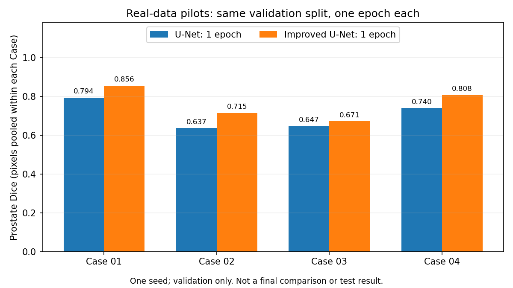

# Improved U-Net：真实数据单轮试跑

本次完成 Improved U-Net 的一个完整 epoch，验证真实六类输入下的训练稳定性、显存、耗时、
保存/重载和预测流程。**20 epoch 正式训练尚未执行，没有评估测试集。**

## 设置与检查

使用与基线单轮试跑相同的清单及设置：课程 31/4/3 个 Case 分组、训练 11,460 张、验证 660 张，
六类标签、前列腺 raw label 5、256×256 pad、base channels 16、batch size 4、
Adam 0.001、seed 3710、float32，不启用随机翻转。模型为已有的残差、InstanceNorm、
LeakyReLU、空间 dropout 和多尺度输出相加的 Improved U-Net 实现。
同 seed 不表示不同模型初始化相同，也不保证 CUDA 重新训练逐位一致。

训练结束且未触发非有限 loss/梯度错误，保存后重新加载的预测完全一致。
随后遍历全部验证切片，按 Case 汇总后合并的像素指标与训练记录完全一致。
模型、源代码、清单及权重哈希见 [训练汇总](results/pilot_improved_unet.json)；
病例指标见 [Case 汇总](results/pilot_improved_unet_cases.json)。

## 同为单轮的初步结果

| 验证指标 | U-Net：1 epoch | Improved U-Net：1 epoch |
|---|---:|---:|
| 验证 loss | 0.5504 | 0.4686 |
| 前列腺像素汇总 Dice | 0.7244 | 0.7919 |
| 前列腺像素汇总 IoU | 0.5679 | 0.6554 |
| 五个前景类别平均 Dice | 0.8215 | 0.8561 |
| 4 个 Case 等权平均前列腺 Dice | 0.7044 | 0.7625 |

各 Case 的 Improved U-Net 前列腺 Dice 为 **0.8558、0.7148、0.6713、0.8080**。
各 Case 内合并所有周次及切片，再对四个 Case 等权平均；不是按扫描分别求平均。
两个模型的单轮实验配置已逐项核对，基线来源为 [单轮记录](results/pilot_unet.json)
与 [病例记录](results/pilot_unet_cases.json)。



这是一个 seed、四个验证 Case 下的早期观察，不能证明架构最终优劣或临床边界可用性。
尤其不能直接将本轮与 [已训练 20 epochs 的基线](FORMAL_UNET.md) 当作相同训练预算的最终比较。
任务 PDF 的目标是测试集前列腺 Dice ≥ 0.75；当前验证均值不能代替测试结果。

## 实测资源与下一阶段预算

| 项目 | U-Net 单轮 | Improved U-Net 单轮 |
|---|---:|---:|
| 参数量 | 1,940,902 | 3,186,802 |
| PyTorch 峰值 allocated（GiB） | 0.296 | 0.648 |
| PyTorch 峰值 reserved（GiB） | 0.420 | 0.855 |
| 训练、训练后验证及保存权重（秒） | 129.56 | 451.92 |
| 单张模型推理中位数（ms） | 2.072 | 5.803 |

这些是不同时间的笔记本运行观察，功耗、频率及其他负载未控制，不能据此得出严格速度比。
显存数据是 PyTorch allocator 范围，不含驱动和其他进程。训练计时不含初始验证与末尾重载/推理检查。
推理使用 5 次预热、20 次 CUDA 同步测量，不含读取/预处理，也不是整病例耗时。

本机 RTX 4070 Laptop GPU 已完成本轮训练，当前配置可继续使用。
按本次单轮耗时线性估算，20 epochs 约 **151 分钟（2.5 小时）**，仅作安排参考。
正式训练仍需从头开始，不能接着这个 pilot 多训 20 轮，否则与基线预算不匹配。
本轮没有启动长训练；固定设置见 [训练计划](TRAINING_PLAN.md)。

## 预测输出与观察

本机文件位于 `runs/real_improved_unet_pilot/`：

- `best.pt`、`config.json`、`summary.json`、`console.log`：权重和运行记录。
- `case_validation/summary.json`：病例指标；`case_details_private.json` 保存原始病例映射和混淆计数。
- `case_examples/prostate_examples.png`：四列分别为 MRI、真实前列腺、预测前列腺、误差叠加。
- `case_examples/selection_private.json` 与 `summary.json`：示例选择依据与误差像素数。

示例与正式基线使用同四张验证切片：各 Case 的前列腺阳性切片按真实标注面积排序，
取下中位数，同面积按清单顺序决定。选择不使用预测效果。白色表示前列腺；红色为误报，蓝色为漏报。

观察到 Case 03 的选定小目标切片漏分明显，切片 Dice **0.4476**，漏报 **113** 个像素，
而整个 Case 的 Dice 为 **0.6713**；Case 04 的选定切片也有 **150** 个漏报像素。
这些例子说明平均分会掩盖局部问题，但只是固定选定的示例，不是完整的 3–5 个边界失败案例分析。
切片的真实解剖方向及物理单位未恢复，不将它们未经核实地称为 base/apex，也不报告毫米距离。
MRI 示例、原始病例编号和权重保留在本机；GitHub 只收录汇总与不含 MRI 的统计图。

## 复现

在项目目录、已激活项目 Python 环境的终端运行。使用新输出目录，避免覆盖本次结果：

```bash
python train.py --model improved_unet --manifest private_data/manifests/course_v1.csv --label-values 0 1 2 3 4 5 --prostate-label 5 --image-size 256 --resize-mode pad --base-channels 16 --batch-size 4 --epochs 1 --lr 0.001 --seed 3710 --device cuda --output runs/real_improved_unet_pilot_reproduce
```

```bash
python evaluate_cases.py --checkpoint runs/real_improved_unet_pilot_reproduce/best.pt --manifest private_data/manifests/course_v1.csv --output runs/real_improved_unet_pilot_reproduce/case_validation --device cuda --batch-size 4
```

模型来源、数据致谢及 AI 使用披露见 [README](README.md)。
