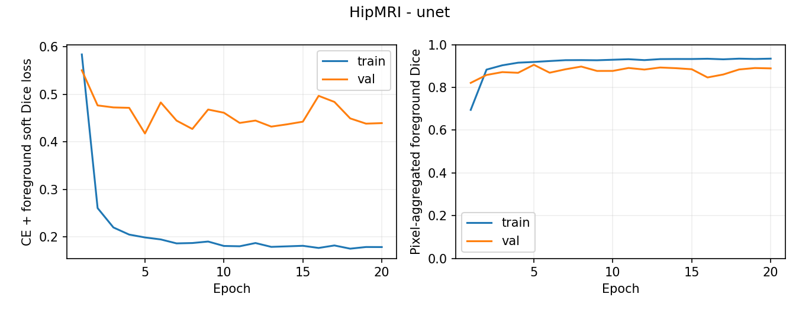
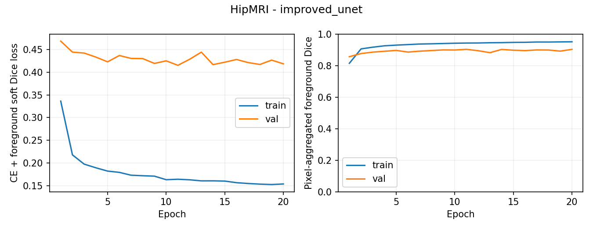
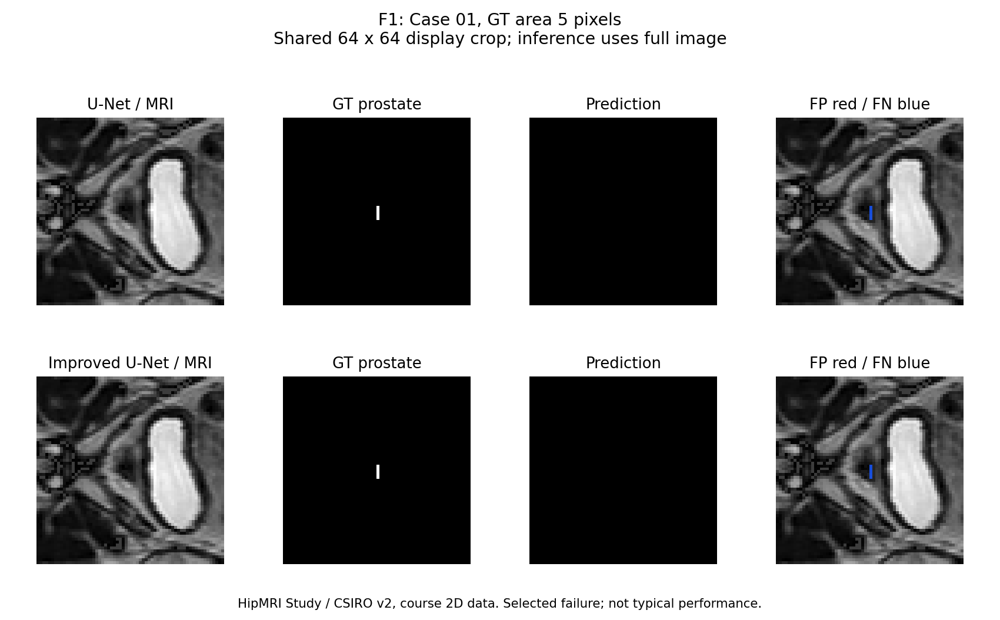
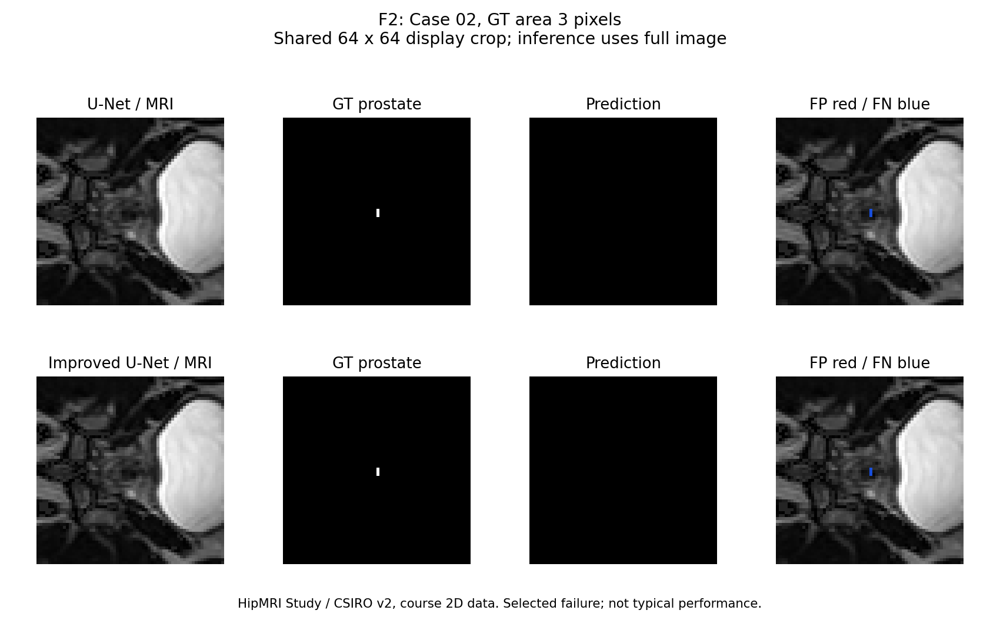
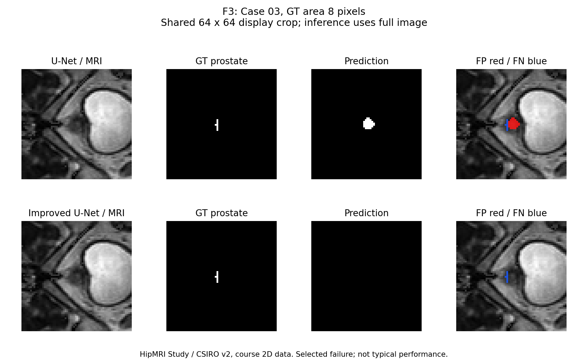
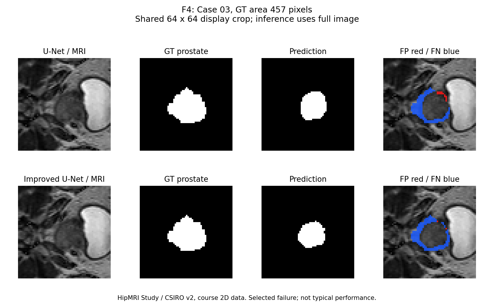
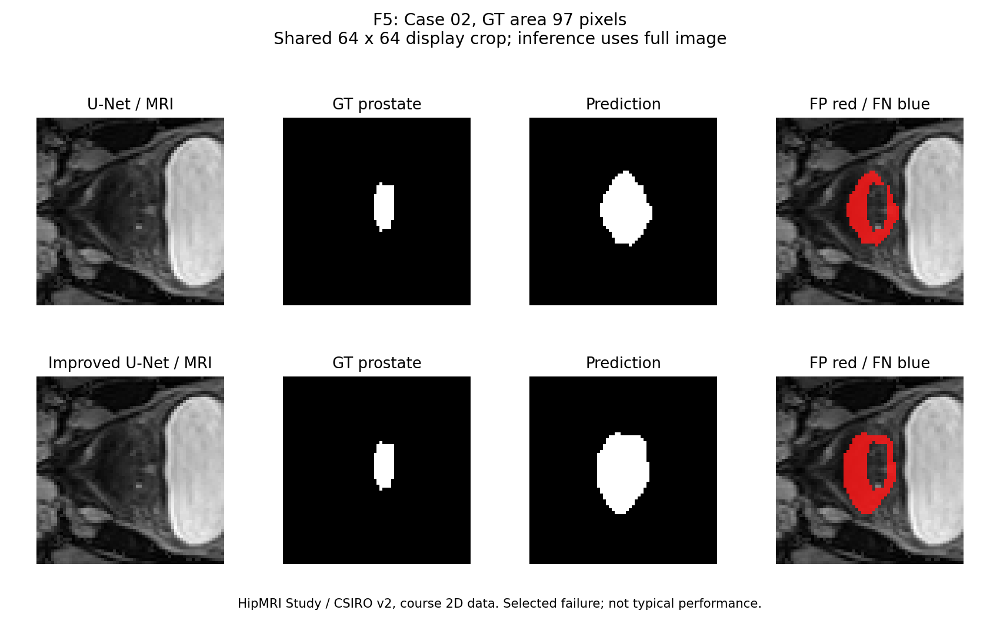

# HipMRI segmentation: does a 2D Improved U-Net improve boundary utility?

**COMP3710 individual project | s4906920 | Normal difficulty: HipMRI 2D Improved U-Net**

## Outcome and engineering recommendation

This project implements a standard 2D U-Net and a residual, deeply supervised
2D Improved U-Net to draft six-class pelvic MRI segmentations for researcher
review. The question is whether extra architectural complexity improves prostate
boundaries enough to justify its computation. Both fixed models exceed the
assignment's prostate test Dice target of 0.75. Improved U-Net slightly improves
pooled test Dice (0.8495 versus 0.8460), but does not improve prostate boundary F1
on the same 195 positive slices (0.8659 versus 0.8675). Small targets and annotation
transitions remain unreliable. For this prototype, retain the smaller U-Net as
the default research baseline; neither model supports unattended contour acceptance.

The implemented choice is the Normal-difficulty 2D Improved U-Net option in
assessment Section 2.2. It is not a 3D model and cannot establish the benefit of
true volumetric continuity or dilated CAN context. Its additional residual and
multiscale processing did not resolve the boundary dilemma on this experiment.
The prototype, final test evaluation, resource measurements and five failure
illustrations are complete. Turnitin submission and later teaching-team code
review responses are separate student actions.

## 1. Requirements, data and evaluation contract

The intended user is an MRI researcher assessing candidate contours, not an
autonomous treatment-planning system. The midpoint feasibility review is retained
below as historical evidence. Its proposed criteria are assessed as follows:

| Criterion | Final evidence |
|---|---|
| Patient-group isolation, alignment and labels | No filename Case overlap across splits; all 12,660 image/mask pairs checked; labels 0-5 fixed. Identity follows the dataset convention, not independently verified personal identity. |
| Prostate held-out Dice at least 0.75 | Both models pass both pooled and equal-Case averaging; all three test Case scores also exceed 0.75. |
| Improved prostate boundary F1 gain at least 0.02, Dice decrease no more than 0.01 | Boundary gain fails: -0.0016 on common GT-positive slices. This negative finding is retained. |
| Peak allocated training memory at most 6 GiB; batch-one model inference at most 100 ms | Both pass in recorded local runs; measurements are hardware- and workload-specific. |
| Reproducibility and 3-5 real failure cases | Fixed hashes, exact checkpoint reload, 73 automated tests, five distinct test-slice autopsies from three Cases. |

The assignment specifies prostate test Dice >= 0.75 without prescribing pooling.
The patient/Case mean is an additional project criterion. Both are reported; the
more favorable aggregation is not selected after seeing results.

### Data source and split

Course data: `/home/groups/comp3710/HipMRI_Study_open/keras_slices_data` on Rangpur.
Original source: HipMRI Study, CSIRO version 2 [3,4]. The local course acquisition
contains 25,320 compressed NIfTI files paired by Case/week/slice filename keys.
Images and masks have matching shapes and affines, finite values and integer
labels; gzip streams were checked in full. Source-file hashes were rechecked
before freezing the manifest, but no remote file-hash inventory was available.

| Split | Cases | Case/week groups | 2D image/mask pairs |
|---|---:|---:|---:|
| Train | 31 | 191 | 11,460 |
| Validation | 4 | 11 | 660 |
| Test | 3 | 9 | 540 |

All weeks and slices of a Case remain in one split. Course assignments are
preserved; `validate` is renamed `val`. `patient_id` in the private manifest is
the original pseudonymous Case convention. The loader rejects Case and resolved
file-path reuse across splits. It does not prove that unrelated filenames cannot
contain duplicate content. The frozen manifest SHA256 is
`5ad6cc420967afc51ec60d0772cfa8c3ff12332db3efe25437693777494c04d3`.

Labels are **0 background, 1 body, 2 bones, 3 bladder, 4 rectum, 5 prostate**.
The official dictionary was cross-checked by exact image/mask correspondence in
three distinct training Cases containing every class. This is not exhaustive
anatomical reannotation. Detailed evidence: [data audit](results/course_download_audit.json),
[label verification](results/label_verification.json), [manifest record](results/data_preparation.json).

### Preprocessing and spatial limits

12,600 pairs are 256 x 128; 60 training pairs are 256 x 144. Each image is
z-scored using its own nonzero pixels, clipped to [-5,5], and padded to 256 x 256.
Masks use a global label-to-channel mapping and identical geometry. The general
resize helper uses bilinear image/nearest-neighbor mask interpolation, but these
course shapes require only padding at size 256. No anatomy is stretched or
removed. Background padding participates in loss and metrics, inflating background
agreement relative to organ scores. No normalization statistics are fitted across splits.

All course slice affines are identity and physical units are unknown. Array
alignment is verified; physical spacing and anatomical orientation are not.
Distances below are pixels, never millimetres. Filename slice order supplies an
annotation-transition proxy, not verified anatomical apex/base direction.

## 2. Models, learning principles and fixed experiment

U-Net [1] combines a contracting path for context with an expanding path for
localization. This independent implementation uses five levels with channels
16, 32, 64, 128 and 256, double padded 3x3 convolutions and ReLU, max-pooling,
transposed-convolution upsampling and concatenated skips. Same padding and
configurable width differ from the original valid-convolution/cropping design.

Improved U-Net adapts Isensee et al. [2] into 2D: stride-two downsampling,
pre-activation residual context blocks, affine instance normalization,
LeakyReLU, Dropout2d(0.3), nearest-neighbor decoder upsampling and concatenated
encoder skips. Three heads at quarter, half and full resolution are resized
and summed as logits. One final segmentation loss propagates gradients through
all three heads; there are not three separately weighted auxiliary losses.
This is an independently written configurable 2D variant, not the paper's full
3D BraTS training, augmentation or ensemble pipeline.

CNN features encode local patterns at multiple receptive fields. Encoder-decoder
skips retain fine spatial information, while residual additions provide shorter
gradient paths. Dropout regularizes training; instance normalization changes
activation scaling. These mechanisms are hypotheses for improved learning, not
guarantees of better boundaries. Both models still process one slice at a time.

Inputs have shape `[B,1,256,256]`; raw output logits have shape `[B,6,256,256]`.
Inference uses six-class argmax without threshold tuning or postprocessing.
Training uses cross-entropy plus the mean foreground soft-Dice loss:
`L = CE + mean_c(1 - (2*sum(p_c*y_c)+1e-6)/(sum(p_c)+sum(y_c)+1e-6))`,
where c ranges over labels 1-5 and sums cover the batch and spatial grid.
Targets remain integer channels for CE and become one-hot inside the Dice term.

| Setting | Both formal runs |
|---|---|
| Initialization / budget | Fresh initialization; 20 epochs; 57,300 updates; no pilot resume |
| Optimization | Adam, learning rate 0.001; batch 4; float32 |
| Randomness / augmentation | Seed 3710; no augmentation; four CPU threads, zero loader workers |
| Selection | Lowest validation CE + foreground soft-Dice loss; ties retain earlier epoch |
| Held-out test | Same frozen split and selected checkpoints; no subsequent fitting or model changes |

U-Net selected epoch 5; Improved selected epoch 11. Validation loss plateaus and
fluctuates while training loss keeps falling; longer training was not uniformly
beneficial. Training metrics accumulate during updates, not in a separate final
train-set evaluation. Reloaded predictions agreed exactly, but PyTorch warned
that CUDA cross-entropy can be nondeterministic: fixed seeds do not guarantee
bitwise-identical retraining. Architecture, optimizer and preprocessing were not
changed after observing test results.





## 3. Held-out overlap and boundary results

Dice is `2TP/(2TP+FP+FN)` and IoU is `TP/(TP+FP+FN)` from integer confusion
counts. Both-empty classes are undefined, excluded with counts reported;
one-empty classes score zero. Pixel pooling sums all test counts first. Case
averaging pools every week/slice within each Case and then weights Cases equally.
Neither reconstructs a physical 3D volume. Complete scores and frozen provenance
are in [U-Net test JSON](results/test_unet.json) and
[Improved test JSON](results/test_improved_unet.json).

| Class | U-Net Dice | Improved Dice | U-Net IoU | Improved IoU |
|---|---:|---:|---:|---:|
| Background | 0.9994 | 0.9995 | 0.9988 | 0.9989 |
| Body | 0.9833 | 0.9847 | 0.9671 | 0.9699 |
| Bones | 0.9285 | 0.9368 | 0.8665 | 0.8811 |
| Bladder | 0.9638 | 0.9647 | 0.9301 | 0.9318 |
| Rectum | 0.8625 | 0.8691 | 0.7582 | 0.7685 |
| Prostate | 0.8460 | 0.8495 | 0.7331 | 0.7384 |
| Foreground macro Dice | 0.9168 | 0.9210 | - | - |

| Test Case | Slices | U-Net prostate Dice | Improved prostate Dice |
|---|---:|---:|---:|
| Case 01 | 420 | 0.8538 | 0.8538 |
| Case 02 | 60 | 0.8453 | 0.8119 |
| Case 03 | 60 | 0.8257 | 0.8562 |
| Equal-Case mean | 540 total | 0.8416 | 0.8406 |

Test Case aliases are not the corresponding validation Cases. Validation
prostate pooled/Case means were 0.8291/0.8090 for U-Net and 0.8320/0.7934 for
Improved. The test set contains only three Cases; hundreds of correlated slices
must not be treated as independent patients. These single-seed differences do
not establish statistical superiority.

### Boundary precision and transition failures

Boundary F1 uses foreground pixels touching background in an eight-neighborhood,
with outside-image pixels treated as background. A predicted contour pixel
matches truth within a two-pixel Chebyshev tolerance (a 5x5 square); precision
and recall produce F1. This is not Euclidean surface Dice or HD95. Arithmetic
means below use the same GT-positive slice population for both models, avoiding
different inclusion counts when one model creates more absent-class false positives.

| GT-positive class | Slices | U-Net boundary F1 | Improved boundary F1 |
|---|---:|---:|---:|
| Body | 540 | 0.9642 | 0.9697 |
| Bones | 540 | 0.9390 | 0.9536 |
| Bladder | 401 | 0.9804 | 0.9815 |
| Rectum | 220 | 0.8646 | 0.8739 |
| Prostate | 195 | 0.8675 | 0.8659 |

| Prostate subgroup | Slices | U-Net boundary F1 | Improved boundary F1 |
|---|---:|---:|---:|
| Small GT area, 1-100 pixels | 28 | 0.6147 | 0.5925 |
| Larger GT area, above 100 pixels | 167 | 0.9099 | 0.9118 |
| First/last positive filename slice per Case/week | 18 | 0.5252 | 0.5079 |
| Other positive slices | 177 | 0.9024 | 0.9024 |

The 100-pixel grouping is a descriptive analysis choice, not an optimized
deployment threshold. Endpoints are annotation transitions only. Their mean
slice Dice is 0.2769/0.3112 despite whole-test pooled Dice above 0.84. Improved
slightly benefits larger targets but worsens small-target boundary F1; this is
consistent with smoothing/coarse-context limitations, not a causal ablation.

Of 345 prostate-absent slices, U-Net predicts prostate on 16 and Improved on 21.
If all defined slices are included, prostate boundary F1 is 0.8018 (211 slices)
and 0.7818 (216 slices); different denominators are explicitly retained.
Total prostate FP/FN pixels are 8,308/9,930 and 8,721/9,268 respectively.
Prostate predictions overlap 542/307 GT bladder pixels and 289/1,004 GT rectum
pixels (U-Net/Improved). Those are label-confusion counts, not measured wall
penetration, dose effects or evidence of patient harm. The extra rectum-label
confusion discourages an unqualified boundary-utility claim.

[Full boundary record](results/test_boundary_analysis.json) includes empty-class
counts and subgroups. Its recomputed overlap scores exactly match the frozen
test evaluation. No new training or test-dependent threshold selection followed.

## 4. Five failure autopsies

These are five distinct slices from three test Cases, not five independent
patients or representative average performance. A deterministic rule selects
the lowest Improved prostate Dice on a positive slice in each Case, then the
largest remaining Improved FN and FP counts; ties use manifest order. Both models
are shown on every selected slice. Selection emphasizes failures, not wins.

Each figure shows MRI, GT prostate, prediction and FP/FN overlay, with U-Net
above Improved. White is prostate, red is false positive, blue is false negative.
All panels share a crop covering the union of GT and both predictions with context;
this is display-only and inference still uses the complete padded slice. Published
figures use aliases without source identifiers, with explicit user authorization.

### F1: complete loss of a five-pixel transition target

Case 01 has five GT prostate pixels on an annotation endpoint. Both models
predict none: Dice and boundary F1 are zero, FN=5. A very small foreground signal
can disappear through repeated downsampling or ambiguous local appearance;
this is a plausible mechanism, not proof of an anatomical location or labeling
error. A high whole-Case Dice hides this complete local miss. Review the
surrounding slice sequence rather than accepting an empty proposal automatically.



### F2: three-pixel target missed in a different Case

Case 02 contains only three GT pixels at another annotation endpoint. Both
models again return empty prostate (Dice/F1=0; FN=3). This recurrence across
Cases supports a small-target weakness, although its pixel severity is tiny and
annotation uncertainty is unresolved. Residual blocks and multiple heads do not
guarantee recovery of weak features. Adjacent-slice and expert annotation review
would be needed before interpreting this as a clinically meaningful miss.



### F3: nearby false positive is not correct localization

Case 03 has eight GT pixels at an endpoint. U-Net misses all eight and predicts
36 nearby wrong pixels; Improved predicts nothing. Both Dice scores are zero.
Nevertheless U-Net boundary F1 is 0.5 because its displaced contour lies within
the two-pixel tolerance; Improved F1 is zero. This exposes a limitation of the
boundary metric itself: tolerance can reward proximity without overlap. Retain
both Dice and FP/FN images; an apparent boundary gain alone is not acceptable.



### F4: conservative contour on a larger target

The 457-pixel target in Case 03 is not an annotation endpoint. U-Net has
174 FN/15 FP pixels and Dice 0.7497; Improved has 188 FN/2 FP and Dice 0.7390.
The blue band spans a substantial part of the GT perimeter: Improved reduces
overreach but removes more true tissue. Local appearance and coarse shape bias
are plausible triggers, not experimentally isolated causes. Review contour extent
even on larger slices; eliminating FP alone is not an adequate acceptance rule.



### F5: enlarged contour and organ-label confusion

Case 02 has a 97-pixel target, fully covered by both predictions, but U-Net adds
216 FP pixels and Improved adds 293. Dice falls from 0.4732 to 0.3984; boundary
F1 is 0.3304/0.3158. Improved's excess includes five GT rectum pixels. The red
ring shows over-expansion into surrounding tissue despite zero FN. Local tissue
ambiguity or an overly broad learned shape may contribute. Review prostate/OAR
interfaces explicitly; this is not evidence of a measured millimetre wall breach.



## 5. Resource cost and operating recommendation

Hardware: NVIDIA GeForce RTX 4070 Laptop GPU, 8 GB, Windows, Python 3.10.19,
PyTorch 2.5.1 with CUDA 11.8, float32. Training peaks below are PyTorch allocated
memory, excluding driver and other processes. Timing observations are not
controlled power/thermal benchmarks.

| Real six-class measurement | U-Net | Improved U-Net |
|---|---:|---:|
| Trainable parameters | 1,940,902 | 3,186,802 |
| Peak training allocated / reserved GiB | 0.296 / 0.420 | 0.648 / 0.855 |
| Training + per-epoch validation/checkpoint minutes | 51.70 | 66.70 |
| Recorded batch-one model inference median ms | 2.000 | 5.149 |

Training time excludes initial validation and final reload/inference checks.
Batch-one inference used five warmups and 20 synchronized repeats, excluding
I/O/preprocessing. Those separate sessions cannot establish a universal speed ratio.

Per-Case timing was repeated after the user stopped gaming. The initial
contended measurements remain archived. Each model/Case uses three repeats,
five warmup forwards, batch 4 and alternating execution order. Median seconds:

| Test Case / slices | U-Net pipeline | Improved pipeline | U-Net forward | Improved forward |
|---|---:|---:|---:|---:|
| Case 01 / 420 | 1.607 | 1.854 | 0.492 | 0.765 |
| Case 02 / 60 | 0.209 | 0.255 | 0.057 | 0.104 |
| Case 03 / 60 | 0.204 | 0.252 | 0.058 | 0.099 |

Pipeline timing includes image reads, preprocessing, transfers, argmax, CPU
predictions and finite/synchronization checks; excludes loading the model, warmup
and output export. Forward sums synchronized GPU forwards only. Case 01 includes
seven weeks, so it is not one scan. No GT files are read for timing. OS cache is
not flushed; absence of all background GPU work was not continuously verified.
Predictions match across repeats and the contended run. Full ranges and scope:
[current benchmark](results/test_case_benchmark_game_closed.json),
[benchmark report](CASE_BENCHMARK.md).

**Recommendation:** keep standard U-Net as the resource-conscious research
default. Improved offers small aggregate overlap gains but more parameters and
memory, longer observed inference, no common-population prostate boundary gain,
and more prostate-absent FP slices. Neither should draft contours for automatic
acceptance. Require specialist review of every case, prioritizing tiny targets,
annotation-transition regions, displaced islands, broad under-contours and OAR
interfaces. A risk flag based on these patterns would itself need validation;
the GT-derived 100-pixel split cannot be used directly at deployment.

A next research experiment could add adjacent-slice context or a 3D baseline,
but should first recover physical spacing/orientation and use a new development/
evaluation plan because this test set has now been inspected. Additional seeds,
larger independent cohorts, expert contour assessment and physical-distance
metrics would be needed before stronger clinical-utility conclusions. This
project does not demonstrate that 3D context is cost-effective; it shows the
limits of the chosen 2D modification.

## 6. Installation, reproduction and code map

Use Python 3.10.19. Runtime pins: torch 2.5.1, numpy 1.26.4, matplotlib 3.10.7,
Pillow 10.4.0 and nibabel 5.3.2. Report pins add reportlab 4.4.4, pypdf 6.1.1 and
PyMuPDF 1.26.4. Install a PyTorch build appropriate for the machine; these runs
used CUDA 11.8. Commands below run from this project directory in an activated
environment. The workspace's `.venv` is local convenience, not a distributable dependency.

```bash
python -m pip install -r requirements.txt
python -m unittest discover -s tests -v
```

Obtain authorized course data and place the six directories beneath
`private_data/keras_slices_data`. Raw NIfTI files, source IDs, private manifests
and trained weights are intentionally excluded from Git. Authorized users can
retrain with the commands below; no public pretrained-weight download is claimed.
The local selected weights are `runs/real_unet_20ep_s3710/best.pt` and
`runs/real_improved_unet_20ep_s3710/best.pt`. Hashes are in [test protocol](TEST_PROTOCOL.md).

```bash
python audit_course_download.py --root private_data/keras_slices_data --output runs/reproduce_audit.json --private-output private_data/source_metadata/reproduce_audit_private.json
python prepare_course_manifest.py --audit-summary runs/reproduce_audit.json --audit-private private_data/source_metadata/reproduce_audit_private.json --report runs/reproduce_preparation.json
python train.py --model unet --manifest private_data/manifests/course_v1.csv --label-values 0 1 2 3 4 5 --prostate-label 5 --image-size 256 --resize-mode pad --base-channels 16 --batch-size 4 --epochs 20 --lr 0.001 --seed 3710 --device cuda --output runs/reproduce_unet
python train.py --model improved_unet --manifest private_data/manifests/course_v1.csv --label-values 0 1 2 3 4 5 --prostate-label 5 --image-size 256 --resize-mode pad --base-channels 16 --batch-size 4 --epochs 20 --lr 0.001 --seed 3710 --device cuda --output runs/reproduce_improved
```

Use new run directories and the unchanged frozen manifest; do not overwrite
published experiments. On another data layout, regenerate the private manifest
and train new checkpoints: arbitrary manifest edits are correctly rejected by
existing checkpoints. Model-only code also runs on CPU with `--device cpu`.

```bash
python evaluate_cases.py --checkpoint runs/reproduce_unet/best.pt --manifest private_data/manifests/course_v1.csv --output runs/reproduce_unet/test --device cuda --split test
python evaluate_cases.py --checkpoint runs/reproduce_improved/best.pt --manifest private_data/manifests/course_v1.csv --output runs/reproduce_improved/test --device cuda --split test
python predict.py --checkpoint runs/reproduce_improved/best.pt --manifest private_data/manifests/course_v1.csv --split test --limit 4 --device cuda --output runs/reproduce_predictions
python analyze_boundaries.py --checkpoints runs/reproduce_unet/best.pt runs/reproduce_improved/best.pt --manifest private_data/manifests/course_v1.csv --output runs/reproduce_boundaries
python render_failure_details.py --analysis runs/reproduce_boundaries --checkpoints runs/reproduce_unet/best.pt runs/reproduce_improved/best.pt --manifest private_data/manifests/course_v1.csv --output runs/reproduce_failure_crops
python benchmark_cases.py --checkpoints runs/reproduce_unet/best.pt runs/reproduce_improved/best.pt --manifest private_data/manifests/course_v1.csv --output runs/reproduce_timing
```

`predict.py` is the reload-and-inference test driver; its first four slices are
not guaranteed to contain prostate. The failure renderer uses the explicit
post-hoc selection rule above. With no course data, verify the software pipeline:

```bash
python train.py --synthetic --model unet --epochs 1 --samples 8 --image-size 64 --base-channels 4 --device cpu --output runs/synthetic_demo
python predict.py --synthetic --checkpoint runs/synthetic_demo/best.pt --device cpu --output runs/synthetic_demo_predictions
```

| Module | Responsibility |
|---|---|
| modules.py | Independent U-Net and residual Improved U-Net architectures |
| dataset.py | NIfTI loading, geometry/label validation, normalization and split isolation |
| train.py | Loss, training/validation, best checkpoint, curves and resource measurements |
| predict.py | Reload checkpoint, predict, save inputs/GT/predictions/error overlays |
| metrics.py | Dice/IoU, CE + soft Dice, pixel-grid boundary F1 |
| evaluate_cases.py | Explicit val/test evaluation, per-Case and pooled scores |
| analyze_boundaries.py / render_failure_details.py | Fixed-model boundary analysis and failure visualizations |
| benchmark_cases.py | Image-only, repeated full-Case inference timing |
| audit_course_download.py / prepare_course_manifest.py | Data checks and immutable split-manifest preparation |
| build_report_pdf.py | Export this README, including figures, to PDF |

Verification: 73 tests passed across model gradients, loss/metric edge cases,
synthetic and artificial-NIfTI training/reload, split isolation, corrupt data,
manifest hashes, benchmark coverage and failure selection. Real-data verification
additionally checked all pairs, exact selected-checkpoint reload, unchanged
weights, matching pooled/Case scores, matching boundary-run test scores and
repeat prediction hashes. No clinical validation is claimed.

Detailed stage records remain available in [training plan](TRAINING_PLAN.md),
[baseline report](FORMAL_UNET.md), [Improved report](FORMAL_IMPROVED_UNET.md),
[test report](TEST_RESULTS.md) and [data access notes](DATA_ACCESS.md).
Historical claims there describe their original stages; this report is the final synthesis.

## 7. Historical one-page feasibility review

The following is the original midpoint review, not a claim that its preliminary
state still applies. Its editable source and one-page rendering remain
[feasibility_review.md](feasibility_review.md) and [feasibility_review.pdf](feasibility_review.pdf).
Final acceptance outcomes and the assignment's aggregation clarification are
reported above. The historical synthetic parameter counts used two output classes;
final resource measurements use six.

<!-- FEASIBILITY_START -->

**Student:** s4906920

### 1. Requirements and scope

For MRI researchers, build a reproducible 2D multiclass
segmentation prototype and determine whether an Improved U-Net reduces boundary
errors enough to justify its compute cost. This is not a clinical deployment.
**Proposed final acceptance criteria**, not achieved results:

1. Zero patient overlap across train/validation/test; verified image-mask pairing,
   one global label dictionary and a confirmed prostate class.
2. Mean patient-level prostate Dice >= 0.75 on the held-out test set; also report
   per-class Dice/IoU and variation across patients.
3. Improved U-Net gains >= 0.02 prostate boundary F1 over the baseline at a fixed
   two-pixel tolerance, with prostate Dice decreasing by no more than 0.01.
4. At the chosen real-data configuration, peak PyTorch allocated training memory
   <= 6 GiB and median batch-one model inference <= 100 ms on the local GPU.
5. Record seeds, splits, configuration and checkpoint reload agreement; explain
   3-5 genuine failure cases. An unmet accuracy target remains a reportable finding.

### 2. Model, data and rationale

Use course HipMRI slices at
`/home/groups/comp3710/HipMRI_Study_open/keras_slices_data`.
Baseline: Ronneberger et al.'s 2D U-Net [1]. Main model: the **Normal-difficulty**
2D Improved U-Net option, adapting Isensee et al. [2] with residual context blocks,
instance normalization, spatial dropout and deep supervision. This applies
multiscale CNN features, skip connections, regularization and gradient
propagation. It is a configurable 2D adaptation, not a complete reproduction of
the paper's 3D BraTS training or ensemble. Compare identical patient splits,
preprocessing and training budgets using cross-entropy plus foreground Dice loss.
Preserve all verified classes; do not merge every nonzero label into prostate.

### 3. Preliminary feasibility evidence

Both models completed six epochs on **synthetic geometric data**: 32 training and
8 validation images, 128 x 128, seed 3710. Saved/reloaded predictions agreed
exactly. Tests cover patient separation, label validation, model gradients and
metric edge cases. These are pipeline checks, not medical accuracy evidence.

Local RTX 4070 Laptop GPU (8 GB), float32, base width 16: a separate short tensor
probe used 256 x 256 inputs, training batch 4, **two output classes**:

| Measurement | U-Net | Improved U-Net |
|---|---:|---:|
| Parameters | 1,940,834 | 3,186,342 |
| Peak allocated / reserved memory (GiB) | 0.290 / 0.438 | 0.639 / 0.820 |
| Median model inference, batch 1 (ms) | 1.395 | 4.224 |

Sources: `results/resource_*.json` and synthetic summaries. CUDA timings are
synchronized; inference excludes preprocessing/I/O. Allocator memory excludes
driver/other processes. Actual HipMRI multiclass costs must be remeasured.
**Real data access, patient metadata and label meanings remain unverified.**

### 4. Risks, budget and next experiments

Provisional post-midpoint budget: 16 working hours and 12 GPU-hours, revised after
a real-data pilot. Next: verify Rangpur access; audit labels, patient IDs, spacing
and overlays; freeze patient splits; run a small U-Net pilot; then compare models
on validation data. Keep test data locked until model choices are finalized.
Risks are delayed access, mislabeled classes, leakage, limited memory and
poor apex/base boundaries. If access is delayed, present measured engineering
evidence and the outstanding dependency. If memory/time is insufficient, reduce
batch/width for both models and document the change; retain U-Net as the fallback.
Tutor discussion and personal check-off remain required.

**References:** [1] [Ronneberger et al., 2015](https://arxiv.org/abs/1505.04597).
[2] [Isensee et al., 2018](https://arxiv.org/abs/1802.10508).
Assessment: `COMP3710_Report_2026_draft_v2.2.pdf`, Sections 2.2 and 3.

<!-- FEASIBILITY_END -->

## 8. Data acknowledgement and references

Data were provided by HipMRI Study: Dowling and Greer, *Labelled weekly MR images
of the male pelvis*, CSIRO Data Access Portal, version 2 [3]. Course-preprocessed
slices were obtained from the COMP3710 Rangpur directory. We acknowledge the
underlying imaging/contouring work [4]. The course terms prohibit participant
identification/contact and commercial use, require acknowledgement and a listed
publication citation, and do not guarantee data correctness. The original
release's separately documented CC BY-NC-ND 4.0 licence is recorded in
[DATA_ACCESS.md](DATA_ACCESS.md). The report distributes only authorized derived
illustrations and aggregate records; raw datasets, original IDs and weights remain
outside Git. Figures are research analysis, not clinical recommendations.

1. Ronneberger, Fischer and Brox (2015). [U-Net: Convolutional Networks for Biomedical Image Segmentation](https://arxiv.org/abs/1505.04597).
2. Isensee et al. (2018). [Brain Tumor Segmentation and Radiomics Survival Prediction: Contribution to the BRATS 2017 Challenge](https://arxiv.org/abs/1802.10508).
3. Dowling and Greer (2021). [Labelled weekly MR images of the male pelvis, CSIRO, version 2](https://doi.org/10.25919/45t8-p065).
4. Dowling et al. (2015). [Automatic Substitute Computed Tomography Generation and Contouring for MRI-Alone External Beam Radiation Therapy From Standard MRI Sequences](https://doi.org/10.1016/j.ijrobp.2015.08.045). IJROBP 93(5), 1144-1153.
5. Course assessment: `COMP3710_Report_2026_draft_v2.2.pdf`, Sections 2.2, 3, 4-6 and checklist.

## 9. Artificial Intelligence Usage Disclosure

OpenAI Codex assisted with assessment interpretation, planning, repository setup,
implementation of data/model/training/evaluation code, tests, experiment execution,
debugging, figure generation, result checking, report writing and PDF export.
This includes both synthetic pilots, real-data pilots, formal 20-epoch runs,
frozen test evaluation, repeated timing, boundary analysis and failure selection.
The architectures were checked against their cited papers; implementation variants
are stated explicitly. No fellow-student or prior-year PR implementation was copied.

Verification combined automated tests and empirical checks listed above, inspection
of prediction/FP/FN figures, and PDF rendering. Known errors were corrected openly:
the assignment did not prescribe patient-mean Dice; earlier midpoint wording was
a project criterion. Timing collected during gaming was marked as contended and
repeated, with both records retained. Improved performance was not presumed, and
its unmet boundary-gain target is reported. AI-assisted hypotheses about failure
causes are distinguished from observed counts and images; no causal ablation or
clinical validation was performed.

The student remains responsible for understanding, reviewing and defending all
code, formulas, metadata and claims. Automated checks and AI assistance do not
replace that responsibility. Source data and patient identifiers were not sent
to an external image-generation service. The student explicitly authorized
publication of the five anonymized derived MRI figures and this illustrated report.

## 10. Submission and review follow-up

The code and report belong on `qinyuan666/PatternAnalysis-2026:topic-recognition`,
with the course PR targeting `shakes76/PatternAnalysis-2026:topic-recognition`.
The PDF is generated directly from this README and its figures:

```bash
python -m pip install -r requirements-report.txt
python build_report_pdf.py --source README.md --output final_report.pdf
```

Submit `final_report.pdf` through the course Turnitin assessment. A GitHub PR
does not replace that upload. After teaching-team feedback is released, review
the comments, commit requested changes and respond within the course's specified
window. Those future interactions cannot be claimed complete in advance.
