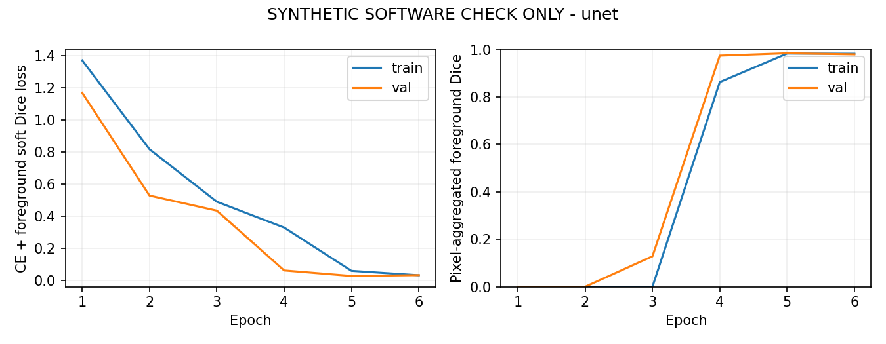
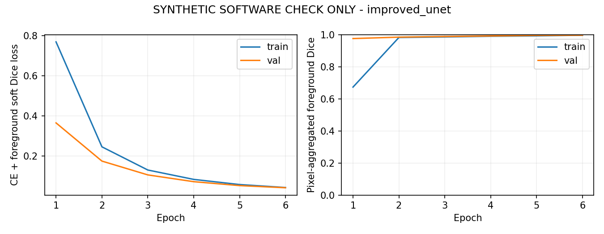
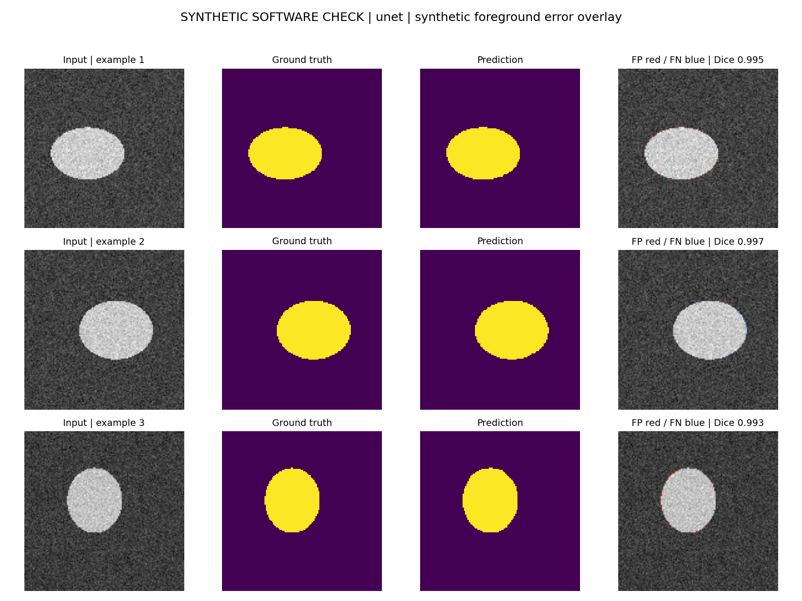
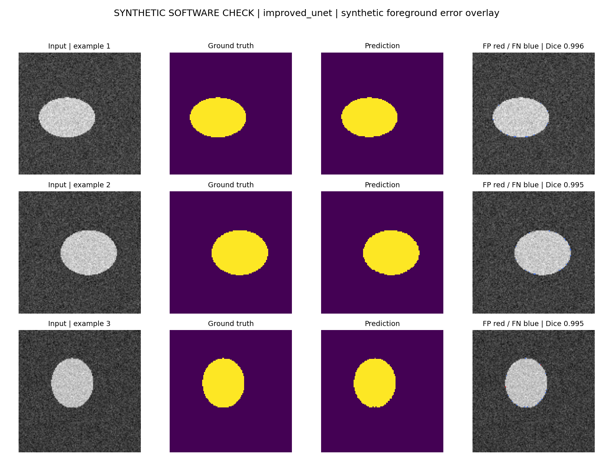

# HipMRI 2D segmentation: U-Net versus Improved U-Net

This individual COMP3710 project investigates whether an Improved U-Net reduces
prostate boundary errors compared with a standard 2D U-Net at an acceptable GPU
cost. The selected task is HipMRI segmentation, with a Normal-difficulty main
model. A synthetic prototype and midpoint review are available. The current
stage has acquired the official original dataset, its label documentation and
the course 2D slice directories. Local acquisition checks pass; finalizing the
training manifest, preprocessing and real-data experiments remains future work.

Student account: **s4906920**. Repository: [course fork](https://github.com/qinyuan666/PatternAnalysis-2026/tree/topic-recognition).

## Project status and midpoint materials

- [One-page feasibility review (PDF)](feasibility_review.pdf), with editable
  [Markdown source](feasibility_review.md), also reproduced below.
- [Chinese discussion notes](MIDPOINT_NOTES_ZH.md): understand the choices,
  measurements and limitations before the tutor discussion.
- [Rangpur instructions](RANGPUR.md): login, bounded inventory, data audit and
  an optional real-data pilot after resource allocation.
- [Data acquisition and local files](DATA_ACCESS.md): official original release,
  label dictionary, integrity checks and the remaining course-2D questions.
- [Course download audit](results/course_download_audit.json): all local files,
  pairing, numeric labels, shapes and filename case-group separation.

| Item | Status |
|---|---|
| Baseline and main model, modular training/prediction | Implemented |
| NIfTI loading, leakage checks, losses/metrics, checkpoint tests | 41 tests passed with artificial fixtures |
| Synthetic training, reload and prediction | Completed for both models |
| Local GPU resource measurements | Completed for the stated tensor configurations |
| Original HipMRI 3D data and label dictionary | Downloaded from CSIRO; ZIP CRC passed; 211 image/mask pairs |
| Course-preprocessed 2D download | 25,320 files / 12,660 pairs locally checked; filename case groups disjoint across course splits |
| Download audit tool | Six targeted tests passed, including truncated gzip and missing-mask failures |
| Training manifest and patient mapping | Not finalized; filename grouping is not independent patient-identity verification |
| Real-data segmentation scores and failure cases | Not obtained |
| Tutor discussion and check-off | Student must attend; not claimed complete |

The task permits preliminary resource evidence for the midpoint. The review below
records the earlier synthetic-prototype stage; the data-source update is in
[results/data_source.json](results/data_source.json). No real-data training,
completed final assessment or successful medical segmentation is claimed.

## Problem and model choices

**Question:** does the improved model reduce prostate contour errors enough to
justify additional GPU cost, compared with a standard 2D U-Net?

The baseline [1] has five encoder levels, double convolutions, max-pooling,
transposed-convolution upsampling and concatenated skip connections. This
implementation uses same padding and configurable channel width, rather than the
original paper's valid-convolution/cropping design.

The main model adapts Isensee et al. [2]: strided downsampling, pre-activation
residual context blocks, instance normalization, LeakyReLU, spatial dropout and
nearest-neighbour upsampling. Three segmentation heads are upsampled and summed
as logits, providing deep supervision. It is a **2D implementation variant** of
the approved Improved U-Net option, not a reproduction of the complete 3D BraTS
training, augmentation or ensemble. Baseline and main model use the same chosen
width and loss, but do not have identical parameter counts.

`build_model(name, in_channels=1, num_classes=2, base_channels=16)` accepts
`unet` or `improved_unet`. Both return raw logits `[B,C,H,W]` at the input size,
supporting dimensions >=32. The real-data class count is set from the verified
global label dictionary; the default two outputs are only the software-check setup.

## Data contract and leakage controls

Course data path: `/home/groups/comp3710/HipMRI_Study_open/keras_slices_data`.
The student's terminal screenshots confirm train/validate/test directories and
five matching training filename keys: `case_<id>_week_<w>_slice_<s>.nii.gz` for
images and `seg_<id>_week_<w>_slice_<s>.nii.gz` for masks. One training pair has
been downloaded and read by the existing `load_nifti_pair`: both arrays are
256 x 128, finite, with matching identity affines and integer mask values 0–3.
The header's physical units are unknown; identity affines do not establish
millimetre spacing. This sample neither defines the global class dictionary nor
verifies patient separation. No training manifest or real-data experiment exists.
For this pair only, both arrays exactly match a plane from the same case/week
in the original release after plane selection and an in-plane flip. The course
filename's slice index differs from the matched original array index; no general
course preprocessing rule is inferred from this single match.

The subsequent full local acquisition audit checked all 12,660 pairs: 11,460
train, 660 validation and 540 test, with respectively 31, 4 and 3 filename case
groups and no case-group overlap. Full gzip-stream and NIfTI reads, pairing,
finite values, matching image/mask shapes and affines, and integer labels passed.
There are 12,600 pairs of shape 256 x 128 and 60 of shape 256 x 144. Observed
mask values are 0–5; numeric values alone do not establish their anatomical
meanings. Every affine is identity and every spatial unit is unknown. Physical
spacing, global label semantics and final preprocessing remain unverified.
No remote per-file inventory or source hashes have been compared.

Reproduce this read-only acquisition audit from the project directory:

```bash
python audit_course_download.py --root private_data/keras_slices_data --output results/course_download_audit.json --private-output private_data/source_metadata/course_download_audit_private.json
```

The public report contains aggregates; filenames, case IDs and locally computed
hashes remain in the ignored private report. This does not create a training CSV
or change the course splits. See [DATA_ACCESS.md](DATA_ACCESS.md) for the limits.
The original public release is now stored privately on the local machine; it
contains 3D volumes rather than this course-preprocessed 2D directory. Its
official raw labels are background 0, body 1, bones 2, bladder 3, rectum 4 and
prostate 5. See [DATA_ACCESS.md](DATA_ACCESS.md) for sources and the distinction
between the original data and the still-unverified course slice preprocessing.

Use a private CSV with `image,mask,patient_id,split`, following the fictional
[example](manifest.example.csv). Relative paths resolve against the CSV directory.
Each patient, including repeated scans/slices, must occur in exactly one split.
The loader rejects patient and resolved-path reuse across splits. Identity still
depends on correct supplied metadata; copied file contents are not hash-deduplicated.

Only true 2D NIfTI arrays or `(H,W,1)` arrays are accepted. Image and mask shape,
affine alignment, finite values and integer labels are checked. An explicit
`--label-values` list fixes the mapping from raw labels to model channels, with
background `0` first. Unknown labels fail. `--prostate-label` must be confirmed
from the dataset documentation: nonzero does not automatically mean prostate.

Images receive per-slice nonzero-voxel z-score normalization, clipped to [-5,5].
Zero padding stays zero. New training runs default to `--resize-mode pad`:
images are resized bilinearly and masks by nearest neighbour with the same
aspect-preserving scale, then centered in a square with zero image/background
mask padding. Use `--image-size 256 --resize-mode pad` for the acquired course
slices: both 256 x 128 and 256 x 144 retain every original array pixel, with
only horizontal padding added. This preserves array proportions, not verified
physical spacing. `--resize-mode stretch` retains the earlier square-stretch
behavior; checkpoints without this setting still use stretch when reloaded.
The mode is saved in the checkpoint and reused by prediction.
Optional flips transform both together and
apply only to training data. No validation/test normalization statistics are fitted.

Training uses cross-entropy plus mean foreground soft Dice loss. Targets are
integer class indices; the Dice term constructs one-hot targets internally.
Reported Dice/IoU pool pixels and return `null` when both prediction and truth
are empty for a class. This is not yet patient-averaged clinical evaluation.
Boundary F1 uses a two-pixel Chebyshev tolerance on the evaluated grid, not mm.
Patient-level reporting and anatomically verified apex/base analysis remain
post-midpoint work, dependent on metadata.

Validation loss selects the checkpoint; test images are not used for selection.
Real prediction must use the **unchanged training CSV**, verified against its
recorded SHA256. Fix the split before tuning and leave the test set locked until
model choices are finalized. A small midpoint pilot may use train/val only,
explicitly reporting the missing final test evaluation.

## Run the project

The following commands run inside `recognition/hipmri_unet_qinyuan666` with the
chosen **Python 3.10** environment active. Exact tested versions are in
[requirements.txt](requirements.txt). On a new machine, create an isolated
environment, install the course-approved PyTorch build, then the requirements;
do not replace a shared/course environment blindly.

```bash
python -m pip install -r requirements.txt
python -m unittest discover -s tests -v
```

This Windows workspace already has a root `.venv` using the existing DQN2
environment's packages plus isolated NIfTI/report dependencies. Its tested
PyTorch is 2.5.1, CUDA runtime 11.8, Python 3.10.19, on an RTX 4070 Laptop GPU.
To run its tests without activating an environment, from repository root:

```powershell
& .\.venv\Scripts\python.exe -m unittest discover -s recognition/hipmri_unet_qinyuan666/tests -v
```

Reproduce synthetic checks in **new output directories** (training refuses to
overwrite an existing checkpoint):

```bash
python train.py --model unet --synthetic --epochs 6 --samples 32 --image-size 128 --batch-size 4 --seed 3710 --device cuda --output runs/reproduce_unet
python train.py --model improved_unet --synthetic --epochs 6 --samples 32 --image-size 128 --batch-size 4 --seed 3710 --device cuda --output runs/reproduce_improved_unet
python predict.py --checkpoint runs/reproduce_unet/best.pt --synthetic --device cuda --limit 3 --output runs/reproduce_unet/predictions
python predict.py --checkpoint runs/reproduce_improved_unet/best.pt --synthetic --device cuda --limit 3 --output runs/reproduce_improved_unet/predictions
```

Use `--device cpu` if CUDA is unavailable; timings will differ. Each training run
saves `best.pt`, configuration, JSON summary and training curves. Prediction saves
an input/ground-truth/prediction/error grid. Checkpoints and raw run directories
are excluded from Git; reproduce weights using the commands above.

```bash
python profile_resources.py --model unet --device cuda --output runs/reproduce_resource_unet.json
python profile_resources.py --model improved_unet --device cuda --output runs/reproduce_resource_improved_unet.json
```

Real-data commands are in [RANGPUR.md](RANGPUR.md), because they require confirmed
patient/label metadata and allocated resources. Do not train from the fictional
manifest or guess anatomical label values.

Seeds and split configurations are recorded. CUDA deterministic settings are
requested with `warn_only=True`; this PyTorch build warns that its CUDA
cross-entropy reduction is not deterministic. Exact retraining equality across
runs/platforms is not guaranteed. The recorded exact agreement is specifically
**saved-checkpoint reload inference**, not an assertion of bitwise identical retraining.

## Recorded preliminary evidence

The full CPU test suite passed **41 tests**, with zero failures or errors; see
[verification record](results/verification.json). Tests use artificial fixtures.

The checked-in summaries and figures below are **synthetic engineering evidence**.
No HipMRI score has been measured. The original training implementation is
identified in each archived summary's provenance.

| Synthetic check: 128×128, 32 train / 8 val, 6 epochs | U-Net | Improved U-Net |
|---|---:|---:|
| Initial validation loss | 1.4524 | 1.6496 |
| Best validation loss | 0.0274 | 0.0407 |
| Selected epoch | 5 | 6 |
| Checkpoint reload exact | Yes | Yes |

Sources: [baseline summary](results/smoke_unet.json),
[improved summary](results/smoke_improved_unet.json).




Separate resource probes: 256×256, base width 16, training batch 4, float32,
Adam, **two output classes**. Each model ran in its own process. Three training
warmups and ten measured steps; batch-one inference used five warmups and twenty
repeats with CUDA synchronization. Short laptop timings vary between runs.

| Resource probe | U-Net | Improved U-Net |
|---|---:|---:|
| Parameters | 1,940,834 | 3,186,342 |
| Peak allocated memory (GiB) | 0.290 | 0.639 |
| Peak reserved memory (GiB) | 0.438 | 0.820 |
| Median training step (ms) | 21.765 | 41.311 |
| Median batch-one model inference (ms) | 1.395 | 4.224 |

Sources: [baseline resource probe](results/resource_unet.json),
[improved resource probe](results/resource_improved_unet.json).
Memory is PyTorch allocator usage, not total device usage. Inference excludes
disk access and preprocessing. Actual multiclass HipMRI costs must be remeasured.

Prediction examples use a separate synthetic seed (5710), distinct from training
and validation. These are illustration examples, not clinical failure cases:




**Current recommendation:** proceed to a small real-data audit and baseline pilot.
The local tensor configuration fits the available GPU, and both software pipelines
run. There is no evidence yet that the improved model benefits real prostate
boundaries. A final recommendation requires matched patient splits, actual
segmentation results and 3–5 genuine failure analyses.

## Written midpoint feasibility review

The following is the same review as the standalone one-page PDF. It records the
midpoint state before the subsequent original-data acquisition; current access
and label findings are documented in DATA_ACCESS.md.

<!-- FEASIBILITY_START -->

**Student:** s4906920

### 1. Requirements and scope

For MRI researchers, build a reproducible 2D multiclass
segmentation prototype and determine whether an Improved U-Net reduces boundary
errors enough to justify its compute cost. This is not a clinical deployment.
**Proposed final acceptance criteria**, not achieved results:

1. Zero patient overlap across train/validation/test; verified image-mask pairing,
   one global label dictionary and a confirmed prostate class.
2. Mean patient-level prostate Dice >= 0.75 on the held-out test set; also report
   per-class Dice/IoU and variation across patients.
3. Improved U-Net gains >= 0.02 prostate boundary F1 over the baseline at a fixed
   two-pixel tolerance, with prostate Dice decreasing by no more than 0.01.
4. At the chosen real-data configuration, peak PyTorch allocated training memory
   <= 6 GiB and median batch-one model inference <= 100 ms on the local GPU.
5. Record seeds, splits, configuration and checkpoint reload agreement; explain
   3-5 genuine failure cases. An unmet accuracy target remains a reportable finding.

### 2. Model, data and rationale

Use course HipMRI slices at
`/home/groups/comp3710/HipMRI_Study_open/keras_slices_data`.
Baseline: Ronneberger et al.'s 2D U-Net [1]. Main model: the **Normal-difficulty**
2D Improved U-Net option, adapting Isensee et al. [2] with residual context blocks,
instance normalization, spatial dropout and deep supervision. This applies
multiscale CNN features, skip connections, regularization and gradient
propagation. It is a configurable 2D adaptation, not a complete reproduction of
the paper's 3D BraTS training or ensemble. Compare identical patient splits,
preprocessing and training budgets using cross-entropy plus foreground Dice loss.
Preserve all verified classes; do not merge every nonzero label into prostate.

### 3. Preliminary feasibility evidence

Both models completed six epochs on **synthetic geometric data**: 32 training and
8 validation images, 128 x 128, seed 3710. Saved/reloaded predictions agreed
exactly. Tests cover patient separation, label validation, model gradients and
metric edge cases. These are pipeline checks, not medical accuracy evidence.

Local RTX 4070 Laptop GPU (8 GB), float32, base width 16: a separate short tensor
probe used 256 x 256 inputs, training batch 4, **two output classes**:

| Measurement | U-Net | Improved U-Net |
|---|---:|---:|
| Parameters | 1,940,834 | 3,186,342 |
| Peak allocated / reserved memory (GiB) | 0.290 / 0.438 | 0.639 / 0.820 |
| Median model inference, batch 1 (ms) | 1.395 | 4.224 |

Sources: `results/resource_*.json` and synthetic summaries. CUDA timings are
synchronized; inference excludes preprocessing/I/O. Allocator memory excludes
driver/other processes. Actual HipMRI multiclass costs must be remeasured.
**Real data access, patient metadata and label meanings remain unverified.**

### 4. Risks, budget and next experiments

Provisional post-midpoint budget: 16 working hours and 12 GPU-hours, revised after
a real-data pilot. Next: verify Rangpur access; audit labels, patient IDs, spacing
and overlays; freeze patient splits; run a small U-Net pilot; then compare models
on validation data. Keep test data locked until model choices are finalized.
Risks are delayed access, mislabeled classes, leakage, limited memory and
poor apex/base boundaries. If access is delayed, present measured engineering
evidence and the outstanding dependency. If memory/time is insufficient, reduce
batch/width for both models and document the change; retain U-Net as the fallback.
Tutor discussion and personal check-off remain required.

**References:** [1] [Ronneberger et al., 2015](https://arxiv.org/abs/1505.04597).
[2] [Isensee et al., 2018](https://arxiv.org/abs/1802.10508).
Assessment: `COMP3710_Report_2026_draft_v2.2.pdf`, Sections 2.2 and 3.

<!-- FEASIBILITY_END -->

To regenerate the PDF from its Markdown source:

```bash
python -m pip install -r requirements-report.txt
python build_review_pdf.py
```

The renderer checks that the result is exactly one A4 page. After changing the
source, also update its embedded copy above and inspect the rendered PDF.

## Data acknowledgement

Data were provided by HipMRI Study via the CSIRO Data Access Portal:
Dowling and Greer, *Labelled weekly MR images of the male pelvis* [4].
The original release and COMP3710 course-preprocessed slice files have been
acquired locally, with acquisition checks described above.
The study's acquisition publication is cited in [5], as listed in the course
data-use notice and the official collection metadata.

The observed course notice requires source acknowledgement and a relevant listed
publication citation in public results, prohibits commercial use and attempts to
identify or contact participants, and provides no guarantee of data correctness.
The original release's separate CC BY-NC-ND 4.0 licence is recorded in
[DATA_ACCESS.md](DATA_ACCESS.md). Raw data and individual filenames remain outside Git.

## Artificial Intelligence Usage Disclosure

OpenAI Codex assisted with interpreting the assessment, configuring the GitHub
fork, planning and implementing the models/data pipeline, writing tests,
debugging, resource measurements, plotting, report drafting and PDF preparation.
Architecture choices were checked against the primary papers. Verification
includes patient/label checks, artificial NIfTI integration tests for both models,
loss/metric edge cases, finite gradients, checkpoint reloads, manifest integrity,
measured synthetic runs and a rendered one-page PDF inspection.

The student must personally understand and review the code, verify real-data
metadata and results, and accurately maintain this disclosure. Automated tests
do not replace that responsibility. No copied student/prior-year PR code is used;
architectural sources are cited below and in model docstrings. No real-data
performance or completed tutor check-off is claimed.

## References

1. Ronneberger, Fischer and Brox (2015). *U-Net: Convolutional Networks for
   Biomedical Image Segmentation*. https://arxiv.org/abs/1505.04597
2. Isensee et al. (2018). *Brain Tumor Segmentation and Radiomics Survival
   Prediction: Contribution to the BRATS 2017 Challenge*.
   https://arxiv.org/abs/1802.10508
3. Course assessment: `COMP3710_Report_2026_draft_v2.2.pdf`, Sections 2.2 and 3.
4. Dowling and Greer (2021). *Labelled weekly MR images of the male pelvis*.
   CSIRO Data Access Portal, Version 2. https://doi.org/10.25919/45t8-p065
5. Dowling et al. (2015). *Automatic Substitute Computed Tomography Generation
   and Contouring for Magnetic Resonance Imaging (MRI)-Alone External Beam
   Radiation Therapy From Standard MRI Sequences*. International Journal of
   Radiation Oncology, Biology, Physics, 93(5), 1144–1153.
   https://doi.org/10.1016/j.ijrobp.2015.08.045
