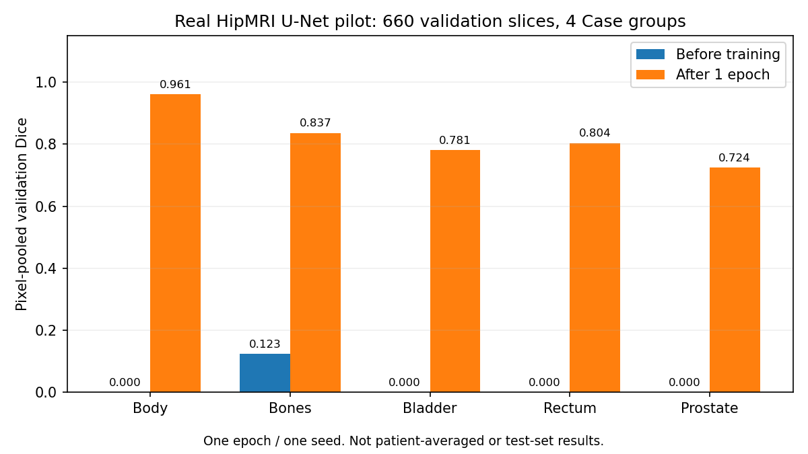

# 真实数据 U-Net 基线试跑

本次只运行一个完整 epoch，检查真实 MRI 的训练、验证、权重保存与预测流程。
它是后续正式实验的起点，不能代替完整训练、模型比较或最终测试集评估。
原先的中期 PDF 和讨论笔记保留为当时的合成数据阶段记录。

## 配置与复现

在本项目目录、已激活项目 Python 环境的终端运行以下单行命令。
第一次实验保存在 `runs/real_unet_pilot`；复现时使用新目录，避免覆盖已保存的权重。

```bash
python train.py --model unet --manifest private_data/manifests/course_v1.csv --label-values 0 1 2 3 4 5 --prostate-label 5 --image-size 256 --resize-mode pad --batch-size 4 --epochs 1 --device cuda --output runs/real_unet_pilot_reproduce
```

| 设置 | 本次取值 |
|---|---|
| 模型 | 标准 2D U-Net，基础通道数 16，6 个输出类别 |
| 标签 | 0 背景、1 身体、2 骨骼、3 膀胱、4 直肠、5 前列腺 |
| 分组 | 保留课程 Case 分组；训练 31 例 / 11,460 张，验证 4 例 / 660 张 |
| 测试集 | 3 例 / 540 张保留，本次不运行测试集预测或评分 |
| 输入 | 单通道，逐切片非零像素 z-score，截断至 [-5,5]，补边至 256×256 |
| 优化 | Adam，学习率 0.001，batch size 4，1 epoch（2,865 次更新） |
| 损失 | Cross-entropy + 五个前景类别的平均 soft Dice loss |
| 随机性 | seed 3710；本轮不启用随机翻转增强 |
| 精度与设备 | float32，本机 RTX 4070 Laptop GPU |
| 权重选择 | 最低验证 loss；本次只有一个训练后的候选 epoch |

实现版本、源代码 SHA-256、清单 SHA-256、权重 SHA-256 和完整指标保存在
[公开汇总](results/pilot_unet.json)。原始运行记录和权重保存在被 Git 忽略的 `runs/` 中。
PyTorch 提示 CUDA cross-entropy 中存在非确定性运算，固定 seed 不保证重新训练逐位一致。
权重重新加载后输出完全一致，是单独的保存/加载检查。

## 结果

本轮已完成，训练和验证过程未出现非有限 loss/梯度错误，保存后重新加载的预测完全一致。

| 验证集类别 | Dice | IoU |
|---|---:|---:|
| 身体 | 0.9611 | 0.9251 |
| 骨骼 | 0.8365 | 0.7190 |
| 膀胱 | 0.7815 | 0.6414 |
| 直肠 | 0.8038 | 0.6719 |
| 前列腺 | **0.7244** | **0.5679** |

五个前景类别的平均 Dice 为 **0.8215**，验证 loss 为 **0.5504**。
参数量为 **1,940,902**；训练、训练后验证及保存权重合计 **129.56 秒**。
该计时不包含训练前验证、最后的重新加载检查或推理测速。
PyTorch 峰值 allocated 显存为 **0.296 GiB**，reserved 为 **0.420 GiB**，
不包含驱动与其他进程的显存。单张模型推理中位数为 **2.072 ms**
（5 次预热、20 次测量，CUDA 同步；不含读取与预处理）。这些是单次笔记本测量值。



指标在全部 660 张验证切片上累加混淆计数后计算，没有先按病例求平均。
它们是验证集分数，不能直接判断作业的测试集前列腺 Dice 目标是否达到。
原任务 PDF 第 6 页要求测试集前列腺 Dice ≥ 0.75，但未明确指定像素汇总或病例等权平均；
本项目同时报告两种聚合方式。此前将逐病例平均说成作业硬性要求的表述已更正。
补边计入 loss 和混淆矩阵，尤其会增加背景像素；前景分数仍可能受到补边区域误报影响。
训练分数在参数不断更新的过程中累计，不是最后权重在训练集上重新评估的分数。

## 输出在哪里

以下路径相对于本项目目录，均保留在本机：

- `runs/real_unet_pilot/best.pt`：本轮模型权重。
- `runs/real_unet_pilot/config.json`、`summary.json`：实际配置、完整指标和资源记录。
- `runs/real_unet_pilot/predictions/prediction_grid.png`：验证集预测图。
- `runs/real_unet_pilot/predictions/summary.json`：示例的前列腺误报/漏报像素数及 Dice。

生成预测图的命令：

```bash
python predict.py --checkpoint runs/real_unet_pilot/best.pt --manifest private_data/manifests/course_v1.csv --split val --limit 4 --device cuda --output runs/real_unet_pilot/predictions
```

图中固定展示清单里前四张验证切片，没有按效果或是否出现前列腺挑选。
四列依次为 MRI、真实标签、预测标签、前列腺误差叠加；最后一列红色是误报（FP），
蓝色是漏报（FN）。全部类别图采用 `viridis` 的 0–5 固定颜色范围。
若真实和预测均没有前列腺，Dice 显示 undefined，不当成满分。
四张示例仅用于检查预测流程，不代表四个病例，也不代表验证集总体效果。
本次前四张切片的真实和预测前列腺均为空，因此四个示例的前列腺 Dice 均为 undefined；
这张图能检查多类别预测输出，但不能展示前列腺轮廓质量。上表的前列腺分数来自全部验证切片。
MRI 示例、病例文件名和权重不上传 GitHub，公开的是汇总指标和不含 MRI 的统计图。

## 下一步

后续已完成按 Case 验证：4 个 Case 的等权平均前列腺 Dice 为 **0.7044**，
完整结果与固定的 20 epoch 训练预算见 [训练计划](TRAINING_PLAN.md)。后续 20 epoch 基线已完成，
其最佳权重和验证结果单独记录在 [正式基线报告](FORMAL_UNET.md)，不覆盖本页单轮 pilot 记录。
接下来用相同分组、预处理和评估方式训练 Improved U-Net，
比较效果和资源成本。超参数及模型选择完成后再做测试集评估与 3–5 个失败案例分析。
课程切片的物理空间单位仍未恢复，不能把像素距离直接报告成毫米。

数据来源和致谢见 [README](README.md#data-acknowledgement) 与 [数据记录](DATA_ACCESS.md)。
